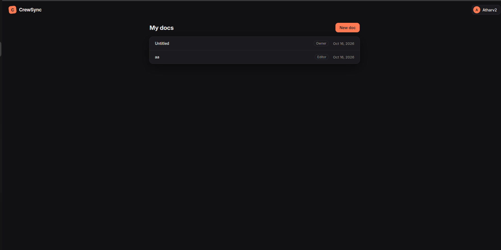
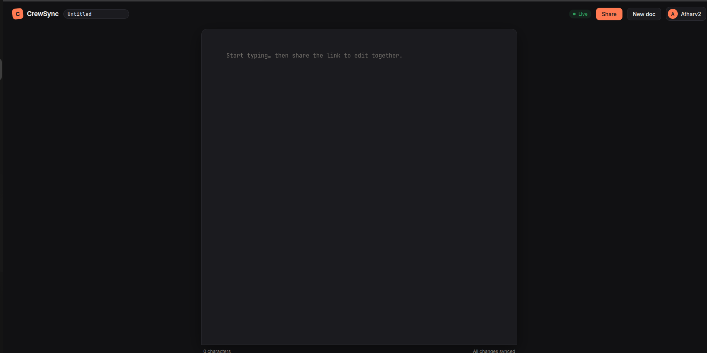

# CrewSync

Real-time collaborative text editor built on a hand-written RGA CRDT, with a Spring Boot server that sequences, stores and relays ops.

**Live:** `<add link>`




## Benchmarks

Measured locally on one laptop (i5-1035G1).

- **0 divergences** in a convergence fuzz: 10,000 seeds, 1.76M shuffled and duplicated ops.
- **50 editors on one doc** at 16.6 ms p95 fan-out latency with 0% errors (down from 17.47 s).
- **259,778-edit real trace** replayed in 0.45 s (Yjs 1.51 s, Automerge 27.4 s).

## Features

- Concurrent editing that converges on every replica, with no locks and no server-side merging.
- Offline edits queue in an outbox and sync on reconnect.
- Presence: who is in the document, with a colored caret for each remote user.
- Accounts, a document list, renaming, and sharing with live access revocation.

## Architecture


The server never merges text: it validates, sequences, stores and broadcasts ops. All merge logic lives in the client's CRDT. Sync, protocol, data model, security and benchmark details are in [working.md](working.md).

## Tech stack

**Client:** React 19, TypeScript, Vite  
**Server:** Java 21, Spring Boot 4.1, PostgreSQL

## Running locally

Requires Java 21, Node 20+ and PostgreSQL.

```sh
cd server && ./mvnw spring-boot:run
cd client && npm install && npm run dev
```

Run the tests with `cd client && npm test` and `cd server && ./mvnw test`. Every environment variable is listed in [working.md](working.md#configuration).

## License

MIT, see [LICENSE](LICENSE). Author: [Atharv Chavan](https://github.com/Atharv3221).