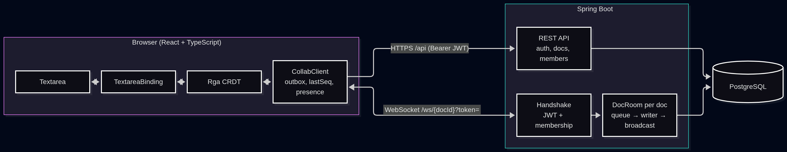
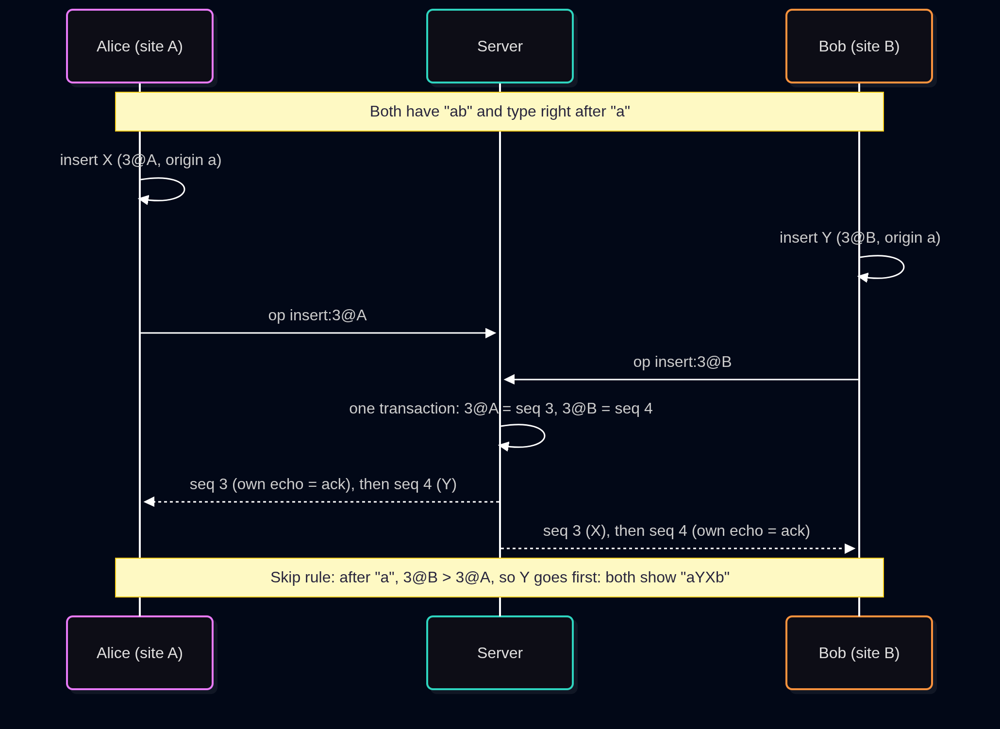

# How CrewSync works

Design and implementation details. For a quick overview see the [README](README.md).

## Architecture



**Why the server is a relay.** The CRDT gives the same text whatever order ops are applied in, so the server never parses or merges content. It validates only the fields that identify an op, gives it the document's next sequence number, stores it, and broadcasts it. Its jobs are durability, a replayable order for catch-up, deduplication and access control. All merge logic lives in the client's `Rga`.

**Per-document writer.** Ops are queued under the room's lock. One writer per document stores up to 100 queued ops (or what arrives within 5 ms) in one transaction and broadcasts them only after the commit, in seq order. Seqs are numbered inside that transaction, so a duplicate never uses one and a failed batch leaves no gap. A failed batch is retried once; if it fails again, its senders are disconnected and resend from their outbox. Messages go out to a snapshot of the sessions, and a session whose send fails is closed without affecting anyone else.

## How sync works

**Ids and the Lamport clock.** Every character has a permanent id `(counter, site)`. `site` is a random 128-bit id per page load. A local op ticks the clock; applying a remote op raises it to `max(clock, op.counter)`. Ids are ordered by counter, then site. Deletes take their own id from the same clock.

**Insert after origin, skip rule.** An insert names its `origin`, the character to its left when typed (`null` = start). A replica goes to the slot after the origin, skips every character with a greater id, and inserts. Concurrent inserts at one spot end up ordered by id everywhere, and text typed after seeing an edit lands where the user typed it.

**Tombstones.** A delete marks the character `deleted` but keeps it, so it still works as an origin. A delete carries its own id plus a `target`, so two users deleting the same character make two distinct ops, and a repeated delete is a no-op.

**Idempotence and the pending buffer.** Each op has a unique key `kind:counter@site`; applying it twice does nothing. An op whose origin or target hasn't arrived waits in a pending buffer and is retried after every op that applies.

**Outbox: the echo is the ack.** Local ops go into an outbox and to the server, which broadcasts each new op to everyone, the sender included. Seeing its own op come back confirms it. After a reconnect the client resends the outbox; the server finds the key already stored (unique `(doc_id, op_key)`) and answers only the sender with the stored op and its original seq.

**seq, lastSeq, hello → init, gap detection.** The server numbers ops per document. On every connect the client sends `hello {lastSeq}` and gets `init` with everything after it; nothing is broadcast to a session before that. A live op with `seq > lastSeq + 1` means something was missed, and the client sends `hello` again.

**Reconnect with an access re-check.** Before each attempt the client calls `GET /api/docs/{id}`. 401, 403 or 404 stops reconnecting and tells the user why; other failures keep backing off. Close code 4403 (access revoked) stops at once.

**IME handling.** During a composition the binding doesn't diff the textarea and holds remote ops. On `compositionend` the result becomes ops and the held ops are applied. The selection is anchored to character ids, so the caret stays beside the same character.



## Protocol

JSON text frames on `/ws/{docId}?token=<jwt>`.

| Direction | `type` | Example |
| --- | --- | --- |
| client → server | `hello` | `{"type":"hello","lastSeq":42}` |
| client → server | `op` (insert) | `{"type":"op","op":{"kind":"insert","counter":7,"site":"9f2c…","origin":{"counter":6,"site":"9f2c…"},"value":"h"}}` |
| client → server | `op` (delete) | `{"type":"op","op":{"kind":"delete","counter":8,"site":"9f2c…","target":{"counter":3,"site":"41ab…"}}}` |
| client → server | `presence` | `{"type":"presence","site":"9f2c…","userId":"…","name":"Ada","cursor":{"counter":7,"site":"9f2c…"}}` |
| server → client | `init` | `{"type":"init","seq":44,"ops":[{"seq":43,"op":{…}},{"seq":44,"op":{…}}]}` |
| server → client | `op` | `{"type":"op","seq":45,"op":{…}}` |
| server → client | `presence` | as above, with `userId` and `name` set by the server |
| server → client | `leave` | `{"type":"leave","userId":"…"}` |
| server → client | `title` | `{"type":"title","title":"Notes","version":3}` |

`value` is one UTF-16 code unit; `origin: null` is the start of the document. Presence is sent on caret moves (throttled to 150 ms) and every 3 s. A duplicate `op` is answered to its sender only, with the original seq.

| Code | Meaning |
| --- | --- |
| HTTP 400 / 401 / 404 / 403 | Handshake refused: bad document id / bad token / no such document / not a member |
| 1007 | Malformed message, or `op`/`presence` before `hello` |
| 1011 | The server couldn't store your ops (after a retry); reconnect and resend |
| 4500 | A send to this session failed (e.g. its buffer overflowed); reconnect |
| 4403 | Access revoked; the client stops reconnecting |

## Data model

PostgreSQL; schema created by Hibernate (`ddl-auto=update`).

| Table | Key | Unique / constraints |
| --- | --- | --- |
| `users` (`name`, `email`, `password_hash`, `created_at`) | `id` UUID | `email` (stored trimmed, lower-case) |
| `documents` (`title`, `title_version`, `created_by`, `created_at`, `snapshot`, `snapshot_seq`) | `id` UUID | FK `created_by` → `users`; snapshot columns unused so far |
| `doc_members` (`role`, `added_at`) | `(doc_id, user_id)` | FKs to `documents` and `users`; `role` in (`OWNER`, `EDITOR`) |
| `ops` (`seq`, `op_key`, `op_json`, `created_at`) | `id` identity | `(doc_id, seq)`; `(doc_id, op_key)`; FK `doc_id` → `documents` |

`(doc_id, seq)` keeps the order unique per document; `(doc_id, op_key)` stores each op once, which turns a resent op into a re-ack.

## Security

- **Passwords**: BCrypt, 8 characters to 72 bytes. Login does one hash comparison even for unknown emails, so timing doesn't reveal which accounts exist.
- **JWT**: HS256 signed with `JWT_SECRET_CREWSYNC`, subject = user id, 7 days by default. Stateless: no sessions or cookies.
- **Membership checks** on every document endpoint (404 if missing, 403 if not a member); invite, remove and rename are owner-only. The WebSocket handshake checks token, user and membership before upgrading.
- **Live eviction**: removing a member closes all their sockets with 4403 after the change commits and tells the others `leave`.
- **Presence identity**: the server overwrites `userId` and `name` with the authenticated user's.
- **Origins**: `ALLOWED_ORIGINS_CREWSYNC` drives both REST CORS (`Authorization` and `Content-Type` headers, no credentials) and the WebSocket origin check.
- **Known tradeoff**: browsers can't set WebSocket headers, so the JWT travels in `?token=`, and query strings can end up in logs (Spring logs the session URI when it closes a session after an error).

## Configuration

Requirements: Java 21, Node 20+, PostgreSQL.

```sql
-- as a Postgres superuser, e.g. sudo -u postgres psql
CREATE USER crewsync WITH PASSWORD 'crewsync';
CREATE DATABASE crewsync OWNER crewsync;
```

| Variable | Default | Notes |
| --- | --- | --- |
| `JWT_SECRET_CREWSYNC` | required | `openssl rand -base64 64` |
| `DATABASE_URL_CREWSYNC` | `jdbc:postgresql://localhost:5432/crewsync` | JDBC URL |
| `DATABASE_USER_CREWSYNC` | `crewsync` | |
| `DATABASE_PASSWORD_CREWSYNC` | `crewsync` | |
| `ALLOWED_ORIGINS_CREWSYNC` | `http://localhost:5173` | Comma-separated origin patterns for CORS and `/ws` |
| `JWT_TTL_CREWSYNC` | `7d` | |
| `PORT` | `8080` | |
| `VITE_API_URL` (client, build time) | unset = same origin | API base for split deployments; the WebSocket URL is derived from it (https → wss) |

```sh
export JWT_SECRET_CREWSYNC="$(openssl rand -base64 64)"
cd server && ./mvnw spring-boot:run
cd client && npm install && npm run dev   # http://localhost:5173, proxies /api and /ws to :8080
```

## Testing

```sh
cd client && npm test && npx tsc -b && npm run lint
cd server && ./mvnw test
```

Last run (2026-10-16): client 118 tests in 14 files, server 206 tests, all passing; `tsc` and `eslint` clean. The server suite includes a stress test where broadcasts race joins, leaves, evictions and broken connections, plus group-commit tests for batching, retry, failure and duplicates. The client suite includes a 200-seed convergence fuzz and large-document Rga tests.

## Benchmarks

One laptop (i5-1035G1, 8 cores), server, Postgres and load generator all local.

| | Before | After |
| --- | ---: | ---: |
| 50 clients × 5 ops/s, one doc: acked ops/s (250 offered) | 207.8 | 249.9 |
| 50 clients: fan-out p95 | 17.47 s | 16.6 ms |
| 50 clients: errors | 33.67% | 0% |
| 10 / 25 clients: fan-out p95 | 8.54 / 8.97 ms | 9.57 / 10.4 ms |
| Rga replay of the 259,778-edit automerge-perf trace | 108 s | 0.45 s |
| Same trace: Yjs / Automerge (unchanged libraries) | 1.47 s / 27.8 s | 1.51 s / 27.4 s |

- Convergence fuzz: 10,000 seeds, 2–8 replicas, 1,761,372 ops delivered shuffled, delayed and duplicated: 0 divergences.
- At 100 clients the single-process load generator saturates (166% CPU), so that level measures the harness, not the server.
- Batching costs a little at low load: ack p50 at 10 clients went from 3.84 ms to 8.29 ms.
